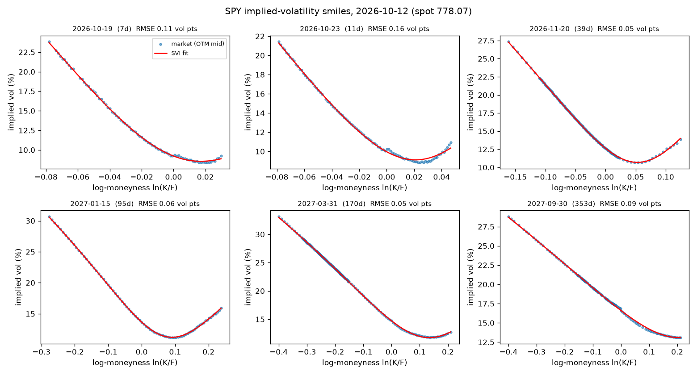
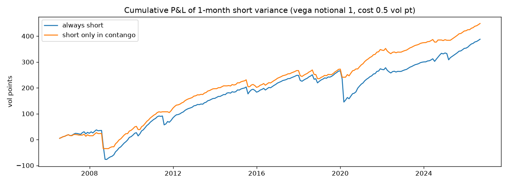

# Volatility Research: Implied Surface, Realized-Vol Forecasting, and the Variance Risk Premium

This project covers three connected pieces of equity-index volatility research:

1. **Implied vol.** It builds an arbitrage-checked SPY implied-volatility surface from raw option quotes.
2. **Realized vol.** It forecasts next-month S&P 500 realized volatility with GARCH, HAR, EWMA and the VIX, all evaluated out-of-sample.
3. **The gap between them.** It measures the variance risk premium (implied minus realized vol) and validates a short-variance strategy, checking whether simple, pre-specified filters avoid its crash months.

Full output: [`outputs/report.md`](outputs/report.md). Interactive surface: `outputs/vol_surface.html`.



## 1. Implied-volatility surface (`volres/surface.py`, `volres/bs.py`)

```
8,454 raw SPY quotes ─► maturity 7-400d ─► two-sided ─► spread ≤ 35% of mid ─► drop stale prints
   ─► forward per expiry (put-call parity) ─► OTM Black-76 implied vols ─► raw-SVI fit ─► arbitrage checks
```

- **Forward, not spot.** Each expiry's forward comes from put-call parity, F = K + (C − P)/DF, using strikes within 3% of spot. This means no dividend assumption is needed.
- **Why only near the money.** A regression across *all* strikes gave DF > 1. The cause is that SPY options are American: deep in-the-money puts carry an early-exercise premium. Near the money that premium is negligible, and so is the error from pricing OTM options as European.
- **Stale quotes.** 26 quotes broke strike monotonicity (for example, the 602 put was quoted *above* the 603 put). That pattern is itself a vertical-spread arbitrage, so those quotes are removed before fitting.
- **Fitting.** Implied vols come from my own Black-76 inversion (Brent's method). Each expiry is fitted with SVI, w(k) = a + b(ρ(k − m) + √((k − m)² + σ²)), using a soft-L1 loss.
- **Result.** All 22 expiries fit within **0.16 vol pts RMSE**.
  - The butterfly check (Gatheral's density condition g(k) ≥ 0) and the calendar check (total variance non-decreasing in maturity) find **0 violations** on the quoted range.
  - The term structure is upward sloping, from 9% to 17%, and the skew flattens with maturity, from 7.9 to 2.8 vol pts per 10% move in strike.

## 2. Forecasting realized volatility (`volres/forecast.py`)

The target is annualized close-to-close vol over the next 21 trading days. The evaluation is out-of-sample over 2000–2026, with **6,713 forecasts per model**. Models are refitted every January on an expanding window.

| Model | RMSE (vol pts) | QLIKE | Bias (f − y) | MZ slope | MZ R² |
|---|---|---|---|---|---|
| VIX (implied) | 8.07 | **0.321** | **+3.60** | 0.90 | **0.520** |
| GARCH(1,1), own MLE | 7.52 | 0.323 | +0.91 | 0.91 | 0.485 |
| HAR + VIX | **7.26** | 0.328 | −0.29 | 1.02 | 0.510 |
| HAR (Parkinson range variance) | 7.38 | 0.331 | +0.16 | 1.07 | 0.495 |
| EWMA (λ = 0.94) | 8.19 | 0.408 | +0.36 | 0.71 | 0.452 |
| Historical 21d | 8.58 | 0.474 | +0.03 | 0.66 | 0.432 |

- **The VIX carries the most information** (highest R², best QLIKE), but it sits **3.6 vol pts above** what is later realized. That gap *is* the variance risk premium.
- **Combining HAR with the VIX** gives the most accurate and nearly unbiased forecast.
- **Data quality.** Before 2006, Yahoo's S&P 500 opens are just the previous close. The HAR inputs therefore use the high-low (Parkinson) estimator, which never touches the open.
- **No look-ahead.**
  - HAR training rows are used only after their 21-day target window has closed.
  - A test checks this by tampering with future targets and asserting that the forecasts don't move. A deliberately leaky version fails the test.

## 3. Validating the variance risk premium (`volres/vrp.py`)

**The trade.** Every 21 trading days, the strategy sells a 1-month variance swap struck at the VIX. P&L = (VIX² − RV²)/(2·VIX) per unit vega notional, minus a **0.5 vol pt cost**.

**How it was validated.** The rules were fixed in advance, so there is no parameter search. Trades don't overlap. Results are checked across sub-periods and across **all 21 possible roll days**.

| Rule (2006–2026, cost 0.5) | Sharpe | t-stat | Hit rate | Skew | Worst month | Max DD |
|---|---|---|---|---|---|---|
| Always short | 0.56 | 2.5 | 81% | −5.4 | −89 (Mar 2020) | −121 |
| **Short only if VIX < VIX3M (contango)** | **1.00** | **4.5** | 82% | −4.7 | −59 (Aug 2008) | **−62** |
| Short only if VIX − HAR forecast > 2 pts | 0.33 | 1.5 | 80% | −4.7 | −89 | −121 |



What the results show:
- **The premium is real but carries crash risk.** Since 1990 it averages 2.2 vol pts a month (t = 5.9), but with a skew of −6.2. It is compensation for crashes, not free money.
- **The term-structure filter helps.** When VIX trades above VIX3M (backwardation), the market is already stressed. Skipping those months avoided March 2020, September 2008 and August 2011.
- **Its limits.** The filter beat always-short on **76% of roll days**, with a median Sharpe of 0.90 vs 0.46. On its worst roll day, though, its Sharpe drops to 0.09. It also could not avoid August 2008 or February 2020, which both started from calm, contango markets.
- **A filter that didn't work.** Filtering on "implied is rich vs my forecast" made things *worse*: the premium is earned most reliably in exactly the calm months when VIX and the forecast agree.

## Run

```bash
python -m venv .venv && source .venv/bin/activate
pip install -r requirements.txt
python run_research.py --refresh   # download S&P/VIX history + snapshot today's SPY chain (~1 min)
python run_research.py             # re-run from cached data
pytest -q                          # 18 tests on synthetic data
```

Tests cover the following:
- Black-76 round-trips and put-call parity.
- Recovering a known SVI surface (including the forward) from a synthetic chain.
- Removing stale quotes, and the butterfly check firing on a bad smile.
- GARCH recovering parameters from simulated data, and its term forecast mean-reverting.
- No look-ahead in the realized-vol target or in HAR.
- The variance-swap P&L arithmetic.

## Limitations

- The surface is one snapshot of delayed Yahoo quotes, with American options inverted as European. That is fine OTM, but it is not a production pricer.
- VIX is used as the variance-swap strike. Real variance-swap levels differ slightly (by discretization and a 30-calendar-day vs 21-trading-day horizon). The 0.5 vol pt cost is an assumption; at 1.0, the contango rule's Sharpe is 0.77.
- The VIX3M filter is a well-known idea and was not discovered here, so these results test it rather than fully out-of-sample it.
