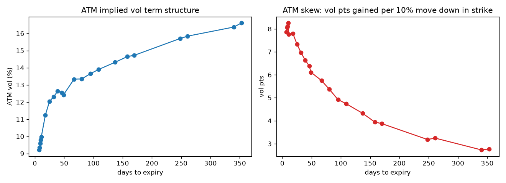
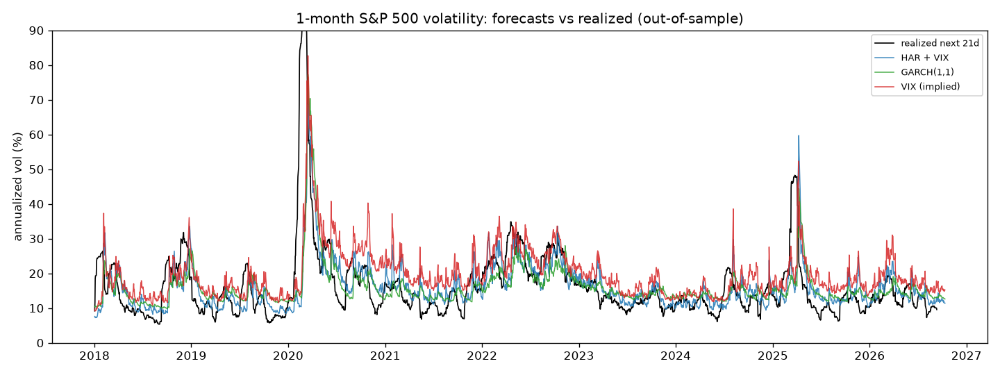

# Volatility research results

Data-quality notes:
- S&P 500 open equals the previous close on >50% of days in 1990-2005: opens are not real before then, so intraday variance uses the high-low (Parkinson) estimator, which never touches the open

## 1. SPY implied-volatility surface (2026-10-12)

Quote funnel: 8,454 raw quotes -> 6,938 with 7-400 days to expiry ->
6,574 two-sided -> 6,335 with spread <= 35% of mid ->
26 dropped for breaking strike monotonicity (stale prints) ->
**3,638 OTM implied vols across 22 expiries**.

- Forward per expiry from put-call parity on strikes within 3% of spot, discounted at the 13-week
  T-bill (4.05%); the forward absorbs dividends.
- Own Black-76 inversion (Brent); median gap to Yahoo's quoted IV: 1.10 vol pts.
- Raw-SVI fit per expiry (soft-L1 loss). Butterfly check (Gatheral g(k) >= 0 on the quoted range):
  min g = 0.058. Calendar check (total variance non-decreasing in
  maturity on overlapping quoted range): **0 violating expiry pairs**.

| expiry | n_quotes | atm_vol_% | skew_per_10%_pts | rmse_vol_pts | min_butterfly_g |
|---|---|---|---|---|---|
| 2026-10-19 | 79 | 9.21 | -7.87 | 0.11 | 0.06 |
| 2026-10-20 | 78 | 9.36 | -8.07 | 0.11 | 0.09 |
| 2026-10-21 | 83 | 9.59 | -8.12 | 0.12 | 0.11 |
| 2026-10-22 | 68 | 9.78 | -8.26 | 0.10 | 0.13 |
| 2026-10-23 | 96 | 9.96 | -7.77 | 0.16 | 0.14 |
| 2026-10-30 | 129 | 11.25 | -7.80 | 0.08 | 0.19 |
| 2026-11-06 | 114 | 12.03 | -7.34 | 0.05 | 0.18 |
| 2026-11-13 | 120 | 12.30 | -6.97 | 0.05 | 0.17 |
| 2026-11-20 | 125 | 12.63 | -6.64 | 0.05 | 0.17 |
| 2026-11-27 | 98 | 12.54 | -6.39 | 0.05 | 0.17 |
| 2026-11-30 | 182 | 12.42 | -6.11 | 0.04 | 0.17 |
| 2026-12-18 | 163 | 13.33 | -5.75 | 0.05 | 0.14 |
| 2026-12-31 | 271 | 13.35 | -5.38 | 0.05 | 0.16 |
| 2027-01-15 | 81 | 13.65 | -4.93 | 0.06 | 0.10 |
| 2027-01-29 | 160 | 13.90 | -4.74 | 0.04 | 0.18 |
| 2027-02-26 | 142 | 14.31 | -4.33 | 0.05 | 0.19 |
| 2027-03-19 | 104 | 14.65 | -3.94 | 0.06 | 0.09 |
| 2027-03-31 | 163 | 14.72 | -3.87 | 0.05 | 0.19 |
| 2027-06-17 | 135 | 15.70 | -3.18 | 0.11 | 0.08 |
| 2027-06-30 | 161 | 15.84 | -3.24 | 0.08 | 0.24 |
| 2027-09-17 | 162 | 16.37 | -2.73 | 0.15 | 0.08 |
| 2027-09-30 | 129 | 16.61 | -2.77 | 0.09 | 0.32 |

Interactive 3-D surface: `outputs/vol_surface.html`.

## 2. Forecasting next-month realized volatility (S&P 500, out-of-sample 2000-2026)

Target: annualized close-to-close vol over the next 21 trading days. GARCH and HAR are re-fitted
every January on an expanding window; HAR training rows are only used once their 21-day target
window has closed, so no forecast sees its own future. QLIKE is the main loss: it ranks variance
forecasts consistently even when the realized target is noisy.

| model | n | rmse_vol_pts | qlike | bias (f - y) pts | mz_slope | mz_r2 |
|---|---|---|---|---|---|---|
| VIX (implied) | 6713 | 8.073 | 0.321 | 3.598 | 0.902 | 0.520 |
| GARCH(1,1) | 6713 | 7.521 | 0.323 | 0.910 | 0.914 | 0.485 |
| HAR + VIX | 6713 | 7.263 | 0.328 | -0.292 | 1.021 | 0.510 |
| HAR | 6713 | 7.381 | 0.331 | 0.164 | 1.065 | 0.495 |
| EWMA (0.94) | 6713 | 8.194 | 0.408 | 0.363 | 0.709 | 0.452 |
| historical 21d | 6713 | 8.580 | 0.474 | 0.031 | 0.657 | 0.432 |

Latest GARCH(1,1): alpha = 0.078, beta = 0.886 (persistence 0.964,
half-life 19 days).

## 3. Alpha validation: the variance risk premium

Sell a 1-month variance swap at the VIX level every 21 trading days (non-overlapping), P&L =
(VIX^2 - RV^2) / (2 VIX) per unit vega notional, minus 0.5 vol pt cost. Rules are fixed in
advance (no parameter search). Sample: Jul 2006 - Sep 2026 (VIX3M starts 2006).

Since 1990 the always-short trade earned 2.23 vol pts per month (t = 5.9),
but with skew -6.2: a steady premium paid for crash risk.

| rule | months | traded | mean_pnl | ann_sharpe | t_stat | hit_rate | skew | worst | max_drawdown | pnl_per_year |
|---|---|---|---|---|---|---|---|---|---|---|
| always short | 242 | 242 | 1.60 | 0.56 | 2.50 | 0.81 | -5.40 | -89.39 | -120.73 | 19.23 |
| short if VIX < VIX3M (contango) | 242 | 211 | 1.85 | 1.00 | 4.48 | 0.82 | -4.67 | -58.68 | -61.54 | 22.24 |
| short if VIX - HAR forecast > 2 pts | 242 | 154 | 0.91 | 0.33 | 1.48 | 0.80 | -4.74 | -89.39 | -120.73 | 10.91 |
| both filters | 242 | 130 | 1.27 | 0.75 | 3.36 | 0.81 | -4.59 | -58.68 | -62.80 | 15.26 |

**Robustness to the roll day** (same rules, all 21 possible start offsets):

| rule | min_sharpe | median_sharpe | max_sharpe | share_of_offsets_better_than_always_short |
|---|---|---|---|---|
| always short | 0.15 | 0.46 | 0.58 | 0.00 |
| short if VIX < VIX3M (contango) | 0.09 | 0.90 | 1.55 | 0.76 |
| short if VIX - HAR forecast > 2 pts | 0.08 | 0.38 | 0.66 | 0.33 |
| both filters | 0.07 | 0.67 | 1.60 | 0.62 |

**Sub-periods** - always short:

| period | months | traded | mean_pnl | ann_sharpe | t_stat | hit_rate | skew | worst | max_drawdown | pnl_per_year |
|---|---|---|---|---|---|---|---|---|---|---|
| 2006-2012 | 78 | 78 | 1.67 | 0.52 | 1.33 | 0.81 | -4.14 | -58.68 | -114.31 | 20.06 |
| 2013-2019 | 83 | 83 | 1.62 | 0.98 | 2.59 | 0.80 | -3.00 | -26.60 | -31.44 | 19.42 |
| 2020-2026 | 81 | 81 | 1.52 | 0.44 | 1.13 | 0.83 | -5.80 | -89.39 | -120.73 | 18.24 |

Short only in contango:

| period | months | traded | mean_pnl | ann_sharpe | t_stat | hit_rate | skew | worst | max_drawdown | pnl_per_year |
|---|---|---|---|---|---|---|---|---|---|---|
| 2006-2012 | 78 | 62 | 2.15 | 0.92 | 2.35 | 0.84 | -5.45 | -58.68 | -61.54 | 25.83 |
| 2013-2019 | 83 | 77 | 1.25 | 0.77 | 2.03 | 0.78 | -2.99 | -26.60 | -33.56 | 14.95 |
| 2020-2026 | 81 | 72 | 2.19 | 1.39 | 3.62 | 0.83 | -3.20 | -31.34 | -31.34 | 26.27 |

**Worst months** for the always-short trade:

| Date | vix | vix3m | rv_fwd | pnl | contango_filter |
|---|---|---|---|---|---|
| 2020-03-05 | 39.62 | 32.57 | 92.81 | -89.39 | skipped |
| 2008-08-28 | 19.43 | 21.54 | 51.37 | -58.68 | traded |
| 2008-09-29 | 46.72 | 36.27 | 84.20 | -53.01 | skipped |
| 2011-07-29 | 25.25 | 22.91 | 48.44 | -34.34 | skipped |
| 2020-02-04 | 16.05 | 16.70 | 35.32 | -31.34 | traded |

